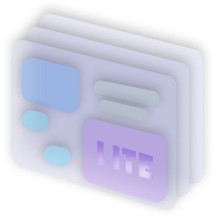
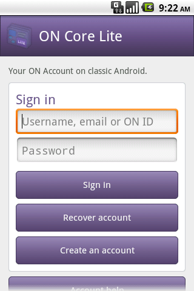
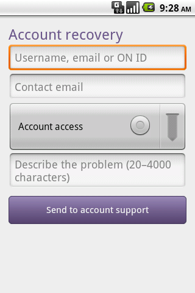

<p align="center">
  
</p>
<p align="center">
  <picture>
    <source media="(prefers-color-scheme: dark)" srcset="docs/branding/oldschool-network-dark.svg">
    
  </picture>
</p>

# ON Core Services Lite

Native ON Account sign-in, registration, recovery, linked profiles and session management for legacy Android. Store Lite uses a signature-protected account bridge; credentials are not exposed to third-party applications.

Current alpha: **0.2**, version code **2**. Android **2.2 / API 8** or later. Intended for legacy devices; use the regular ON editions on current Android.

## Screenshots

<p>
  
  
</p>

## Design and compatibility

Native XML layouts and recycled lists. No Material, AndroidX or WebView application screens. Network requests use a private, relocated Bouncy Castle TLS implementation with certificate-chain and hostname verification. System certificate validation is never disabled.

The target SDK remains 10 for legacy behaviour. Current Android versions can reject installation because of this old target; this is not a modern-device replacement for the regular ON apps.

## Build

Use JDK 8, Android SDK platform 28 and build-tools 28.0.3. The wrapper uses Gradle 5.4.1 and Android Gradle Plugin 3.5.3. Configure the SDK in your own local.properties.

```text
gradlew.bat assembleDebug
gradlew.bat assembleRelease -x lintVitalRelease
```

The shared module is embedded in `shared/` in this repository. In the multi-project development workspace, the project can also use sibling `ONLiteShared`. No signing keys or credentials are included. Release APKs are signed separately with the persistent ON key.

## Release policy

Lite releases are scheduled independently. Regular Core, Store and Installer updates do not rebuild or publish Lite packages automatically.

## Current limits

Early alpha. No complete offline catalogue or full background automatic-update parity with regular ON apps. Store Lite requires server build-0011. Testing includes Android 2.2 ARM with 128 MB memory; physical devices and ROM-specific behaviour need further verification.

## Links

[Website](https://oldschoolnetwork.online) · [Documentation](https://oldschoolnetwork.online/downloads/docs/) · [Bluesky](https://bsky.app/profile/oldnet.bsky.social) · [YouTube](https://www.youtube.com/@oldschoolnetwork) · [X](https://x.com/oldschool_net) · [Telegram](https://t.me/OldschoolNetwork)
